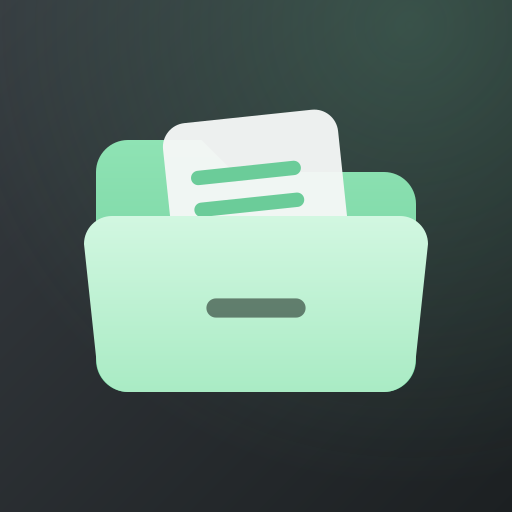
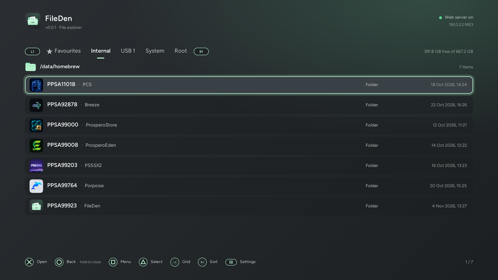
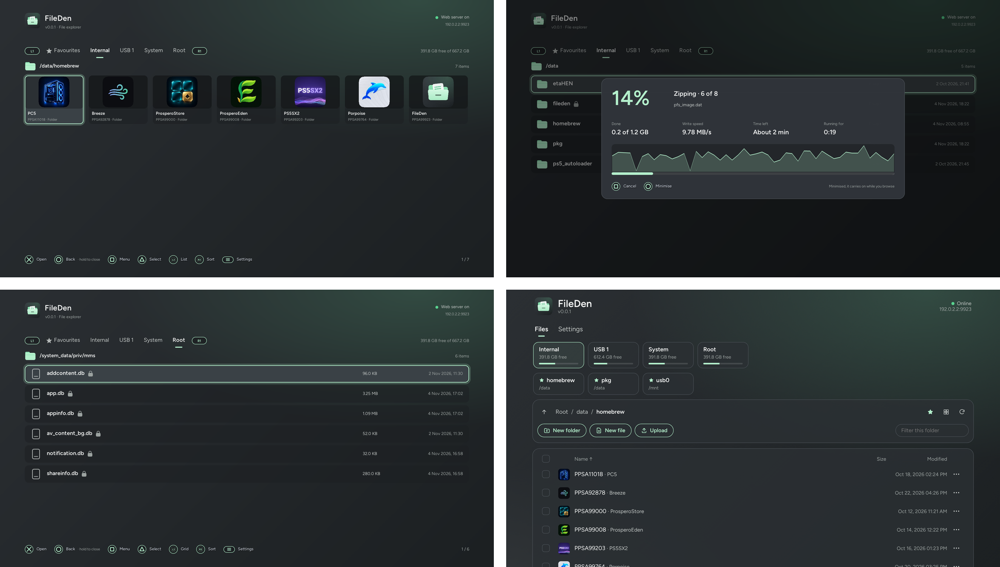

<div align="center">



# FileDen

**A file manager for jailbroken PS5 consoles, with a web UI for your phone.**


[Download](https://github.com/realLesiedd/FileDen/releases/latest) · [Install](#install) · [Controls](#controls) · [Changelog](CHANGELOG.md)



</div>

## Features

- **Files**: copy, move, rename, delete, new folder or file, multi-select, undo the last rename or move
- **Background jobs** with progress, write speed and time left; minimise and keep browsing, or queue more
- **Archives**: extract ZIP, 7z, RAR / RAR5, TAR (gz, xz, bz2, zst), ISO and more; compress to ZIP, 7z or TAR;
  passwords supported
- **Game and app icons and names** for title folders and `.pkg` files
- **Image viewer** (including PS5 HDR `.jxr` screenshots), **grid view**, **text editor**
- **Info and permissions**: size, SHA-256, dates, any mode from `0000` to `7777`
- **Web UI** at `http://<PS5-IP>:9923/` with drag-and-drop upload and download
- Favourites, five themes, menu sounds, and PS5 system files locked so they can't be changed

## Screenshots



## Install

Needs a jailbroken PS5 running **kstuff** and **ShadowMountPlus**.

1. Copy the `PPSA99923` folder from [`FileDen-PPSA99923.zip`](https://github.com/realLesiedd/FileDen/releases/latest) to `/data/homebrew/` and add it with ShadowMountPlus.
2. Open **FileDen**.
3. Optional: open `http://<PS5-IP>:9923/` on a phone or PC.

## Controls

- **Move around**: ✕ open, ◯ back (hold to close), L1 / R1 tabs, L2 / R2 first / last
- **Pick and act**: △ select (hold to select all), □ menu
- **View**: L3 grid or list, R3 sort, Touchpad job progress, Options settings

Settings › About and controls has the full list in the app.

## Build

Needs the [ps5-payload-sdk](https://github.com/ps5-payload-dev/sdk), `cmake`, `make`, `clang`, `curl` and Python 3.

```sh
export PS5_PAYLOAD_SDK=/opt/ps5-payload-sdk
tools/fetch-deps.sh
${PS5_PAYLOAD_SDK}/bin/prospero-cmake -B build . && make -C build
app/fself/build.sh build/fileden.elf
```

Protected paths, the API and PC testing are in [docs/DEVELOPMENT.md](docs/DEVELOPMENT.md).

## Credits

Built with the [PS5 Payload SDK](https://github.com/ps5-payload-dev/sdk) by John Törnblom. Full list of
third-party code in [THIRD_PARTY_NOTICES.md](THIRD_PARTY_NOTICES.md), which also credits the homebrew apps in the
screenshots.

Parts of FileDen were written with the help of AI (Claude).

## Support

FileDen is free. If you'd like to say thanks:

[](https://buymeacoffee.com/realleseid)

## License

GPL-3.0, see [LICENSE](LICENSE).

<sub>FileDen is not affiliated with or endorsed by Sony Interactive Entertainment. PlayStation and PS5 are trademarks of Sony Interactive Entertainment Inc.</sub>

---

Copyright © 2026 [realLesiedd](https://github.com/realLesiedd)
